# Grim Fronteira - Marshal Tutorial

Screenshots of the actual game interface. Captions and numbered callouts explain the controls.

**Branch:** feature/post-deploy-polish
**Commit:** d2592b2731ba0919ed7dd2950be64947bc17e349
**Captured:** 5 October 2026
**Capture size:** 1280 x 720 CSS pixels (browser default).

**Advanced pages 13–16:** captured 19 October 2026 on feature/marshal-advanced-tutorial, using the real TableRouterView and engine-generated isolated sample states. No live games or player credentials were used.

## Reading order

### 01. Create your game

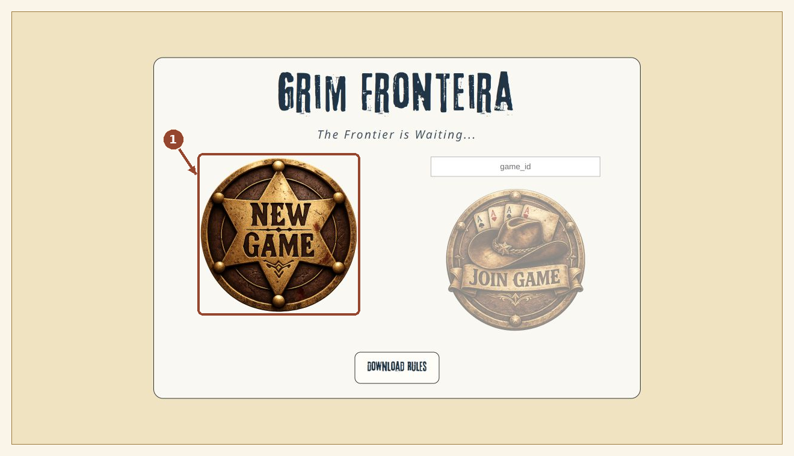

Click New Game (1). You become the Marshal of a new game.

### 02. Invite your players

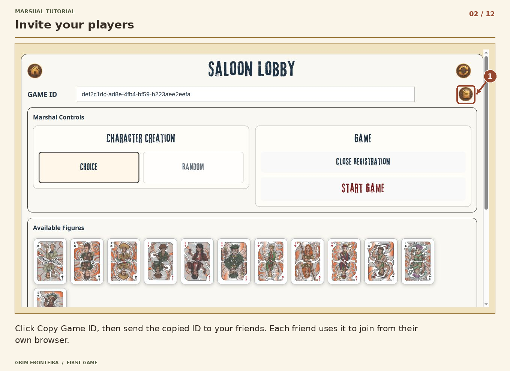

Click Copy Game ID (1), then send the copied ID to your friends. Each friend uses it to join from their own browser.

### 03. Choose character assignment

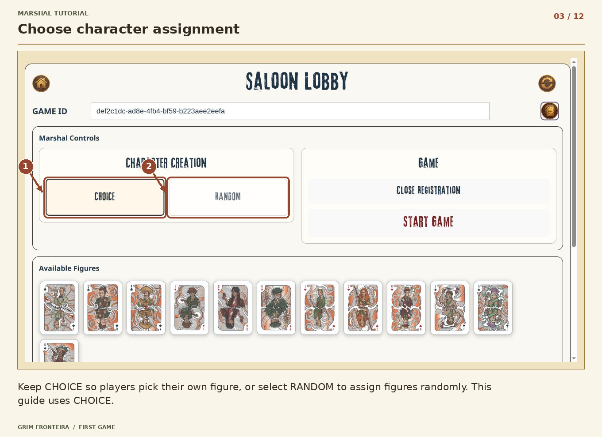

Keep CHOICE (1) so players pick their own figure, or select RANDOM (2) to assign figures randomly. This guide uses CHOICE.

### 04. Start when everyone is ready

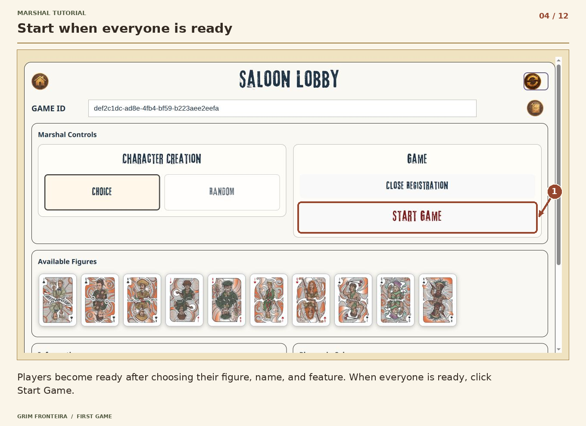

Once at least one player has joined and every joined player has chosen a figure, name, and feature, click Start Game (1). Players become ready automatically when their character is complete.

### 05. Choose the opening story

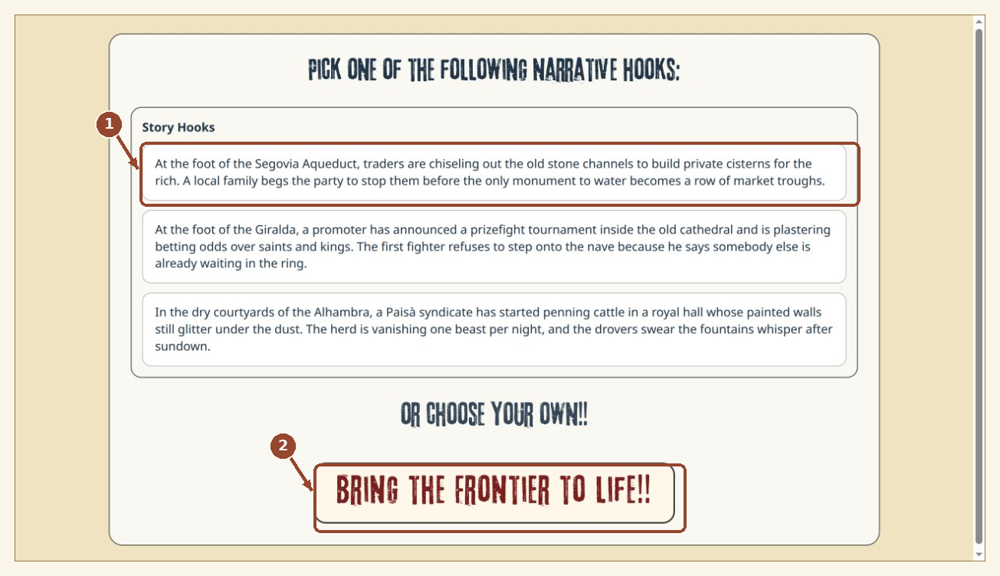

Choose a suggested narrative hook, such as the highlighted Story Hook (1), or prepare your own. Then click Bring the Frontier to life!! (2) to move to the game table.

### 06. Choose who is in the scene

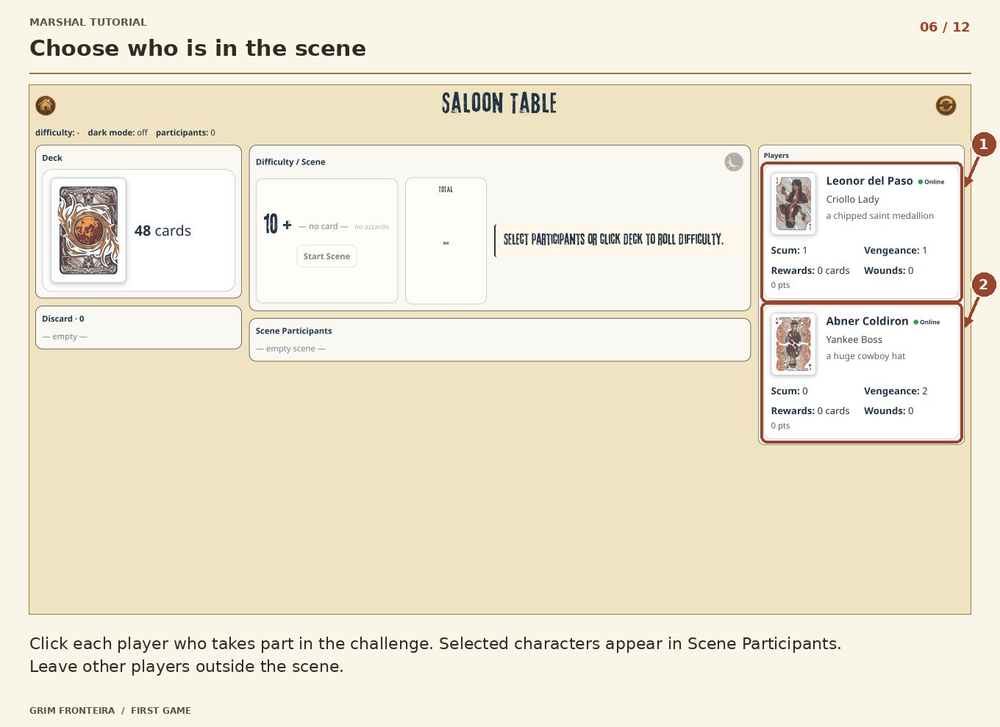

Click Leonor del Paso’s player panel (1) and Abner Coldiron’s player panel (2) to include both in this challenge. Selected characters appear in Scene Participants. Leave other players outside the scene.

### 07. Set the challenge

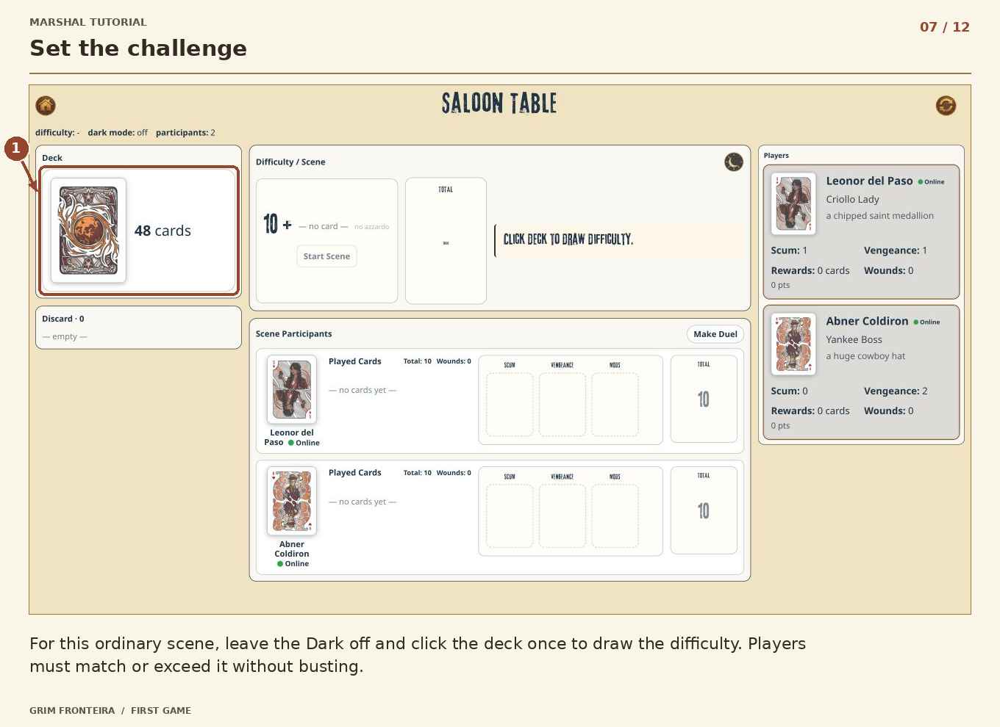

For this ordinary scene, leave the Dark off and click the deck (1) once to draw the difficulty. Players must match or exceed it without busting.

### 08. Deal the first hands

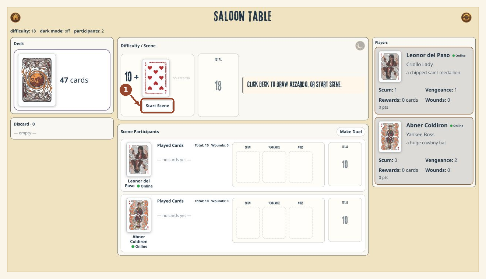

The difficulty is set. Click Start Scene (1) to deal one card to each participant. For this introductory scene, skip the optional Azzardo.

### 09. Follow the player turns

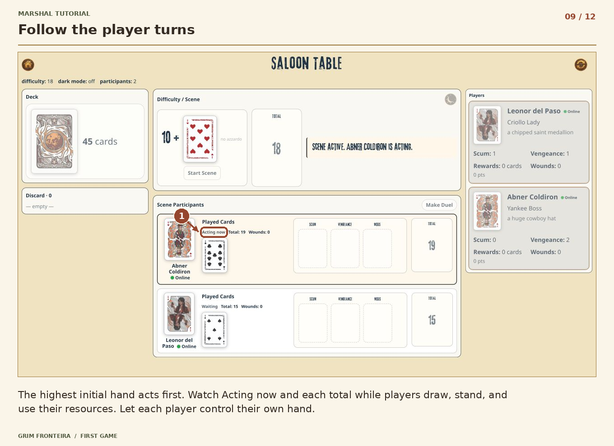

The highest initial hand acts first. The Acting now label (1) identifies the current player—in this screenshot, Abner Coldiron. Follow each total while players draw, Stay, and use their resources. Let each player control their own hand.

### 10. Review results and wait

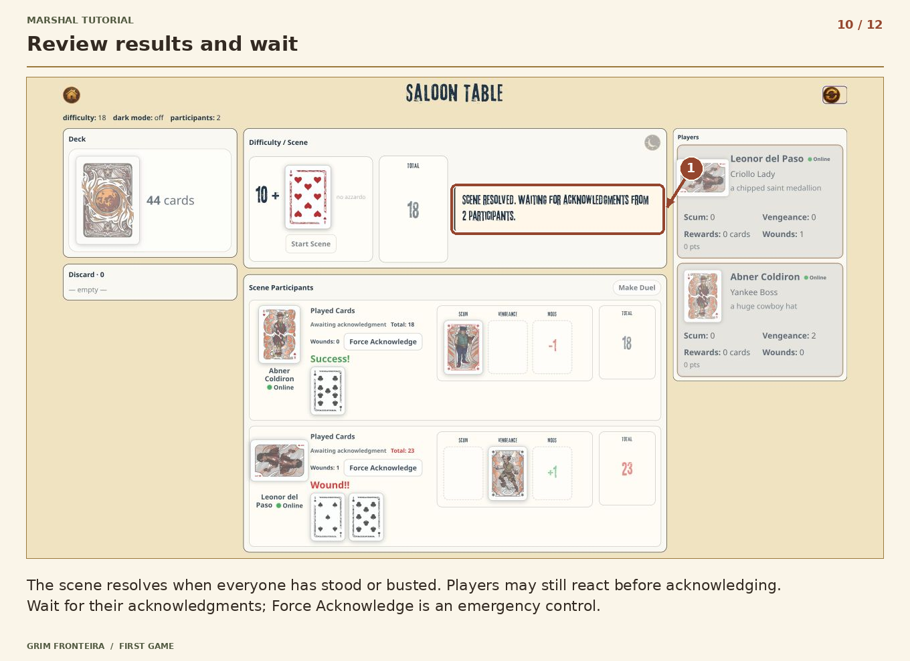

The status message (1) says the scene is resolved and is waiting for acknowledgments from 2 participants. Players may still react before acknowledging. Wait for their acknowledgments; Force Acknowledge is an emergency control.

### 11. Close the completed scene

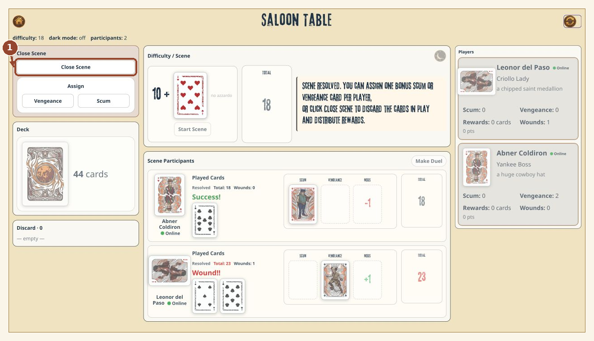

Once acknowledgments are complete, click Close Scene (1). This deals earned Rewards and clears the played cards. Optional bonus Scum or Vengeance can be assigned before closing.

### 12. Prepare the next scene

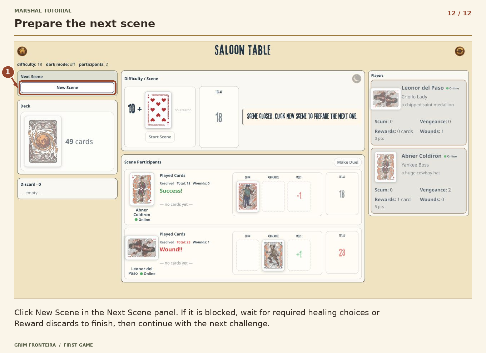

Click New Scene (1) in the Next Scene panel. If it is blocked, wait for required healing choices or Reward discards to finish, then continue with the next challenge.

### 13. Advanced: add or return Azzardo

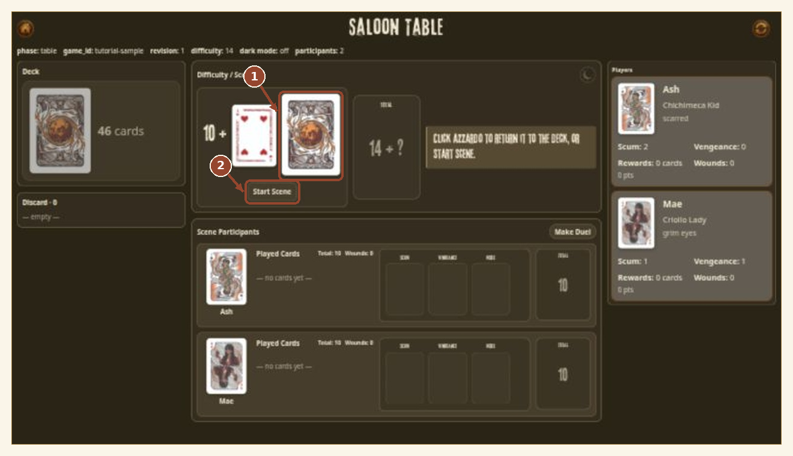

After choosing participants and drawing an ordinary numbered difficulty below 21, click the deck once more to add optional Azzardo. The extra card stays face down (1), and the total shows '+ ?'. Before Start Scene (2), click that face-down card to return it to the deck if you change your mind. Starting locks this choice. The deck disables Azzardo for Ace, figure and Joker difficulties; Azzardo is also unavailable in Dark and PvP duels.

### 14. Advanced: resolve an Azzardo scene

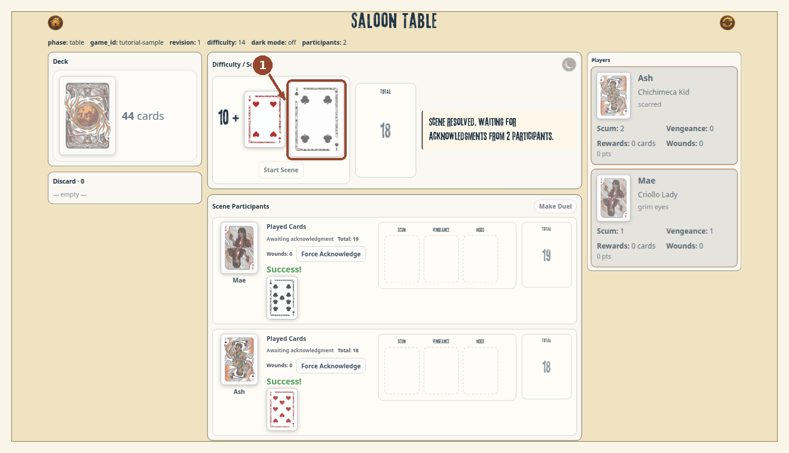

Players draw and Stay normally without knowing the extra difficulty. Azzardo turns face up (1) automatically when the scene resolves. Here the opening difficulty is 10 + 4 = 14, and Azzardo adds 4 for a final target of 18. Mae's 19 and Ash's 18 both succeed. If Azzardo pushes the Marshal's target over 21, non-busted participants succeed. Wait for player reactions and acknowledgments, then Close Scene to deal one Reward to each successful participant. Azzardo does not grant Dark's double Rewards.

### 15. Advanced: declare the Dark before dealing

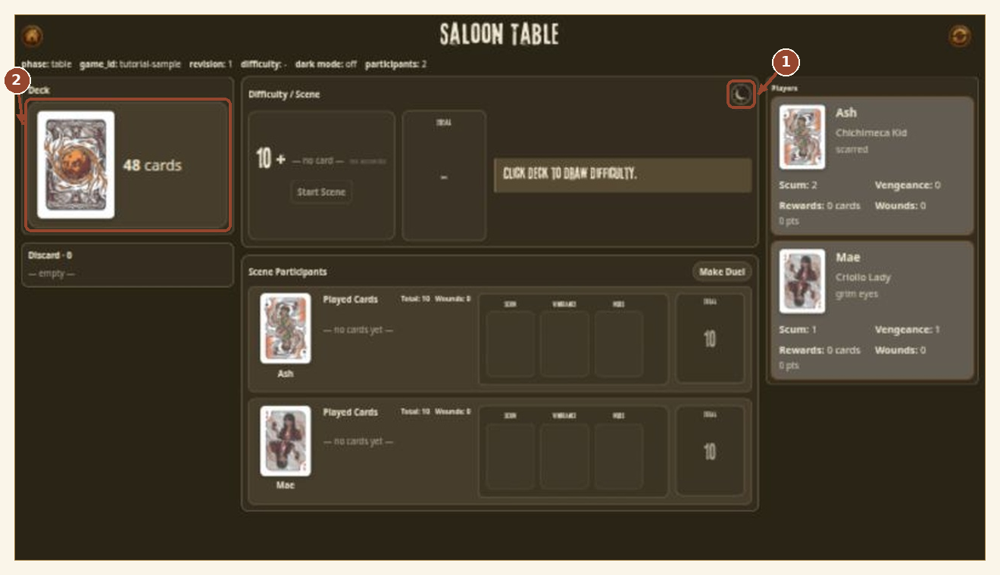

Start with a fresh scene and choose its participants. Before drawing any difficulty or choosing Azzardo, click Declare the Dark (1), the small Dark icon in Difficulty / Scene. Then click the deck (2) for the opening hidden difficulty and Start Scene to deal the players' hands. The Marshal sees the opening card; players see a concealed hand and no target value. Use Dark for a final confrontation or a moment of high tension. Dark cannot be combined with Azzardo or a PvP duel; it resets on New Scene.

### 16. Advanced: manage and reveal the Dark hand

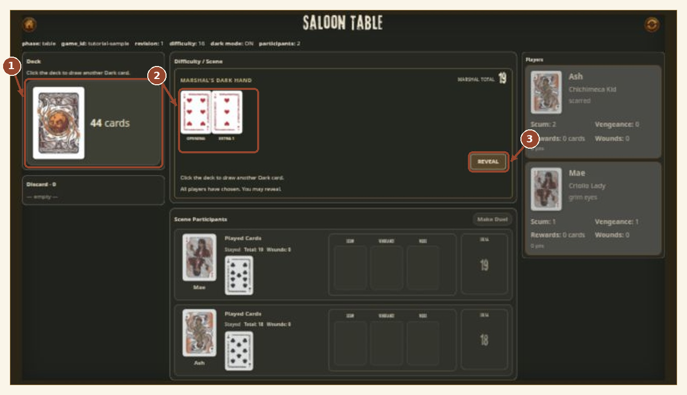

During setup or while players act, click the deck (1) to add cards to your private Dark hand (2). If your total exceeds 21, click the last extra Dark card to discard it before continuing; you cannot reveal while over 21. After every participant has Stayed or busted, REVEAL (3) becomes available. Here your hidden total is 10 + 6 + 3 = 19: Mae's 19 succeeds for two Rewards, while Ash's 18 fails and takes one wound. A failed player also loses one Reward if they have one, choosing it after Close Scene. Reveal, allow reactions and acknowledgments, then Close Scene. Resolve Reward losses, healing and overflow choices before New Scene.

## Editing and regeneration

Edit the corresponding record in ../captures.json and run ../render_annotations.py with Python 3 and Pillow. The script regenerates PNGs, editable self-contained SVGs, steps.json, and this reading-order guide. Original screenshots remain unchanged.
Use --metadata-only to update steps.json and this README without modifying any images. Numbered markers follow the marks array order, starting at 1. Titles and captions stay outside the PNGs and SVGs.

## Scope and verified flow

Verified through an ordinary two-player scene, player acknowledgments, Close Scene, Reward distribution, and New Scene. The UI automatically marks a character ready after name and feature selection.

Marshal pages 13–16 cover Azzardo setup and resolution, Dark declaration, hidden-hand management, reveal timing, double Rewards and failure consequences. Healing, excess-Reward selection and other faction powers remain advanced follow-ups.

These are isolated local sample states. No invitations were sent and no live game or deployment was changed.